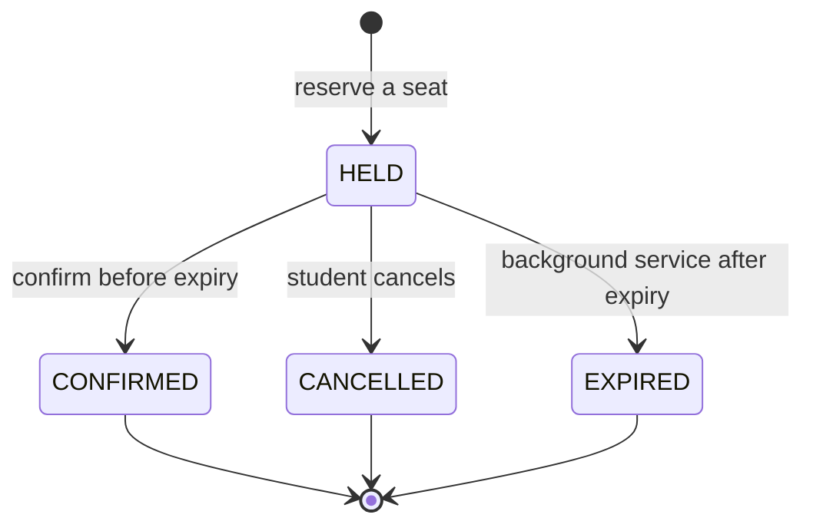

# School Admission System

A full-stack school admission platform where students reserve a seat with a time-limited hold and confirm their admission before the hold expires. Built with an **ASP.NET Core 8 + PostgreSQL** API and a **React 19 + Vite + Tailwind CSS 4** frontend.

The project was built as an assignment around one core correctness requirement:

```text
heldSeats + confirmedSeats <= totalSeats
```

This invariant must hold even when many students request the last seat at the same time.

---

## Table of Contents

- [Features](#features)
- [Tech Stack](#tech-stack)
- [Architecture](#architecture)
- [Hold Lifecycle](#hold-lifecycle)
- [Data Model](#data-model)
- [API Reference](#api-reference)
- [Business Rules](#business-rules)
- [Concurrency and Expiration](#concurrency-and-expiration)
- [Frontend](#frontend)
- [Getting Started](#getting-started)
- [Configuration](#configuration)
- [Testing](#testing)
- [Verification Performed](#verification-performed)
- [Project Structure](#project-structure)
- [Assumptions](#assumptions)
- [AI Usage](#ai-usage)
- [Commit History](#commit-history)

---

## Features

### Student portal

- Student identity through a 17-digit Student ID, validated with Zod and sent as the `X-Student-Id` header.
- Live class grid showing capacity, confirmed seats, held seats, and available seats.
- Availability states: **Open**, **Few seats left**, **Class full**.
- One-click seat reservation with an immediate success/error panel per class.
- Application history with:
  - live countdown for `HELD` applications,
  - **Confirm admission** action,
  - **Cancel** action,
  - clear status panels for `HELD`, `CONFIRMED`, `EXPIRED`, and `CANCELLED`.
- Automatic refresh: classes every 5 seconds, applications every 5 seconds.
- Class names are resolved for each application, even when only `classId` is returned by the API.
- Loading skeletons, empty states, and a retryable service-unavailable screen.

### Admin console

- Read-only dashboard summary: total classes, total capacity, confirmed seats, seats on hold, available seats, and occupancy percentage.
- Create-class form with client-side validation and server-side validation errors.
- Per-class table with occupancy bars and **Open / Low / Full** indicators.
- Manual refresh of the class list.

### Backend

- Layered design: Controllers → Services → Repositories → EF Core → PostgreSQL.
- Repository and Unit of Work patterns.
- DTOs for all request/response payloads.
- Hold statuses serialized as strings (`HELD`, `CONFIRMED`, `EXPIRED`, `CANCELLED`).
- Row-level locking and advisory locks for safe seat allocation.
- Configurable hold duration with a default of 600 seconds.
- Background service that expires overdue holds every 5 seconds.
- Swagger UI in the Development environment.
- Dockerfile for containerized deployment.

### Quality

- 11 integration tests, including a dedicated concurrency test.
- Frontend lint with Oxlint: 0 warnings, 0 errors.
- Production build through Vite.
- Documentation for assumptions and AI usage.

---

## Tech Stack

| Layer | Technology |
| --- | --- |
| Backend runtime | ASP.NET Core 8 (`net8.0`) |
| API style | REST, `[ApiController]`, attribute routing |
| ORM | Entity Framework Core 8.0.11 |
| Database | PostgreSQL (Npgsql EF Core provider 8.0.11) |
| API docs | Swashbuckle / Swagger UI |
| Tests | xUnit 2.9, `Microsoft.AspNetCore.Mvc.Testing` |
| Frontend | React 19, Vite 8 |
| Styling | Tailwind CSS 4 with `@tailwindcss/vite` and a CSS-first `@theme` |
| HTTP client | Axios 1.21 |
| Validation | Zod 4 |
| Linting | Oxlint |
| Container | Docker (multi-stage .NET 8 build) |

---

## Architecture

```text
┌─────────────────────────────┐
│  React frontend (Vite)      │
│  http://localhost:5173      │
│  Axios + Tailwind UI        │
└──────────────┬──────────────┘
               │ JSON over HTTPS
               │ X-Student-Id header
┌──────────────▼──────────────┐
│  ASP.NET Core Web API       │
│  https://localhost:7151     │
│                             │
│  Controllers                │
│      ↓                      │
│  Services (business rules)  │
│      ↓                      │
│  Repositories + UnitOfWork  │
│      ↓                      │
│  EF Core / Npgsql           │
└──────────────┬──────────────┘
               │
┌──────────────▼──────────────┐
│  PostgreSQL                 │
│  classes / holds            │
└─────────────────────────────┘
```

### Request flow

1. The browser sends a request to the API base URL from `VITE_API_BASE_URL`.
2. Controllers validate headers and delegate to services.
3. Services enforce business rules and open a database transaction when seats are mutated.
4. Repositories execute EF Core queries, including `SELECT ... FOR UPDATE` and `pg_advisory_xact_lock`.
5. DTOs are returned as JSON. Enum values are serialized as strings.

---

## Hold Lifecycle



- **HELD** counts as an occupied seat.
- **CONFIRMED** counts as an occupied seat permanently.
- **EXPIRED** and **CANCELLED** release the seat.
- A student may have at most one active `HELD` hold and at most one `CONFIRMED` admission across the whole system.

---

## Data Model

### `classes`

| Column | Type | Notes |
| --- | --- | --- |
| `Id` | `uuid` | Primary key |
| `Name` | `varchar(150)` | Required, indexed |
| `TotalSeats` | `integer` | Required, at least 1 |
| `CreatedAt` | `timestamptz` | UTC |

### `holds`

| Column | Type | Notes |
| --- | --- | --- |
| `Id` | `uuid` | Primary key |
| `ClassId` | `uuid` | FK → `classes.Id`, cascade delete, indexed |
| `StudentId` | `varchar(100)` | Required, indexed |
| `Status` | `text` | `HELD`, `CONFIRMED`, `EXPIRED`, `CANCELLED`; indexed |
| `ExpiresAt` | `timestamptz` | Hold deadline (UTC) |
| `CreatedAt` | `timestamptz` | UTC |
| `ConfirmedAt` | `timestamptz` | Nullable |
| `CancelledAt` | `timestamptz` | Nullable |

EF Core configurations live in `Backend/SchoolAdmission.Api/Data/Configurations/`.

### Seat accounting

`GET /classes` and `GET /classes/{classId}` calculate:

```text
heldSeats      = HELD holds where ExpiresAt > now
confirmedSeats = CONFIRMED holds
availableSeats = TotalSeats - heldSeats - confirmedSeats
```

Expired holds are excluded from the held count even before the background worker marks them `EXPIRED`.

---

## API Reference

**Base URL (development):** `https://localhost:7151`
**Swagger UI:** `https://localhost:7151/swagger`
**Student identity:** `X-Student-Id` request header on student-specific endpoints.

### Endpoint summary

| Method | Route | Identity | Success | Purpose |
| --- | --- | --- | --- | --- |
| `POST` | `/classes` | — | `201 Created` | Create a class |
| `GET` | `/classes` | — | `200 OK` | List classes with seat counts |
| `GET` | `/classes/{classId}` | — | `200 OK` | Get one class |
| `POST` | `/classes/{classId}/holds` | `X-Student-Id` | `201 Created` | Reserve a seat |
| `GET` | `/holds/{holdId}` | — | `200 OK` | Get hold details |
| `GET` | `/holds` | — | `200 OK` | List all holds |
| `POST` | `/holds/{holdId}/confirm` | `X-Student-Id` | `200 OK` | Confirm an admission |
| `DELETE` | `/holds/{holdId}` | `X-Student-Id` | `204 No Content` | Cancel a hold |
| `GET` | `/me/holds` | `X-Student-Id` | `200 OK` | List a student's holds |

### Create a class

```http
POST /classes
Content-Type: application/json

{
  "name": "Class 6 - Morning Shift",
  "totalSeats": 120
}
```

`201 Created`

```json
{
  "id": "9a4acb2c-7828-485c-933b-9845186d0f4b",
  "name": "Class 6 - Morning Shift",
  "totalSeats": 120
}
```

Validation errors return `400 Bad Request` through model validation.

### List classes

`200 OK`

```json
[
  {
    "id": "9a4acb2c-7828-485c-933b-9845186d0f4b",
    "name": "Class 6 - Morning Shift",
    "totalSeats": 120,
    "heldSeats": 0,
    "confirmedSeats": 5,
    "availableSeats": 115
  }
]
```

### Get a class

`200 OK` with the same shape as a list item. Unknown IDs return `404 Not Found`.

### Reserve a seat

```http
POST /classes/9a4acb2c-7828-485c-933b-9845186d0f4b/holds
X-Student-Id: 20152691234500123
```

`201 Created`

```json
{
  "holdId": "14e88cca-8f19-4720-bc6a-013d294b7d08",
  "classId": "9a4acb2c-7828-485c-933b-9845186d0f4b",
  "studentId": "20152691234500123",
  "status": "HELD",
  "expiresAt": "2026-11-11T15:04:56.816022Z"
}
```

Possible errors:

| Status | Reason |
| --- | --- |
| `400` | `X-Student-Id` missing/blank, or invalid argument |
| `404` | Class does not exist |
| `409` | Student already has an active hold |
| `409` | Student already has a confirmed admission |
| `409` | No seats are available for this class |
| `500` | Unexpected server error |

### Get a hold

```http
GET /holds/14e88cca-8f19-4720-bc6a-013d294b7d08
```

`200 OK`

```json
{
  "holdId": "14e88cca-8f19-4720-bc6a-013d294b7d08",
  "classId": "9a4acb2c-7828-485c-933b-9845186d0f4b",
  "status": "HELD",
  "expiresAt": "2026-11-11T15:04:56.816022Z"
}
```

Returns `404 Not Found` for unknown holds.

### List all holds

`200 OK` with a list of:

```json
{
  "holdId": "14e88cca-8f19-4720-bc6a-013d294b7d08",
  "classId": "9a4acb2c-7828-485c-933b-9845186d0f4b",
  "studentId": "20152691234500123",
  "status": "HELD",
  "expiresAt": "2026-11-11T15:04:56.816022Z"
}
```

### Confirm a hold

```http
POST /holds/14e88cca-8f19-4720-bc6a-013d294b7d08/confirm
X-Student-Id: 20152691234500123
```

`200 OK` with the hold payload, now `"status": "CONFIRMED"`.

| Status | Reason |
| --- | --- |
| `400` | `X-Student-Id` missing/blank |
| `403` | The hold belongs to another student |
| `404` | Hold or class not found |
| `409` | Hold is not in `HELD` status |
| `409` | Hold has expired |

### Cancel a hold

```http
DELETE /holds/14e88cca-8f19-4720-bc6a-013d294b7d08
X-Student-Id: 20152691234500123
```

`204 No Content`. The status becomes `CANCELLED` and the seat returns to the available pool.

Errors follow the same `400 / 403 / 404 / 409` rules as confirmation. Only `HELD` holds can be cancelled.

### List a student's holds

```http
GET /me/holds
X-Student-Id: 20152691234500123
```

`200 OK` with holds ordered by `CreatedAt` descending. A missing header returns `400 Bad Request`.

### curl examples

```bash
# List classes
curl -k https://localhost:7151/classes

# Reserve a seat
curl -k -X POST https://localhost:7151/classes/<classId>/holds \
  -H "X-Student-Id: 20152691234500123"

# Confirm
curl -k -X POST https://localhost:7151/holds/<holdId>/confirm \
  -H "X-Student-Id: 20152691234500123"

# Cancel
curl -k -X DELETE https://localhost:7151/holds/<holdId> \
  -H "X-Student-Id: 20152691234500123"

# My applications
curl -k https://localhost:7151/me/holds \
  -H "X-Student-Id: 20152691234500123"
```

`-k` is only required because the local development certificate is self-signed.

---

## Business Rules

1. A class requires a name (max 150 characters) and at least 1 seat.
2. A seat is occupied while a hold is `HELD` and unexpired, or when it is `CONFIRMED`.
3. A student can have only one active `HELD` hold system-wide.
4. A student can have only one `CONFIRMED` admission system-wide.
5. `HELD` holds expire after `HOLD_DURATION_SECONDS` (default 600).
6. Only the owning student can confirm or cancel a hold.
7. Only `HELD` holds can be confirmed or cancelled.
8. An expired hold cannot be confirmed.
9. Expired holds are marked `EXPIRED` by a background worker and stop occupying seats.
10. No real authentication or payment is implemented; confirmation simulates a successful payment.

---

## Concurrency and Expiration

### Safe seat allocation

Seat creation runs inside a database transaction:

1. `pg_advisory_xact_lock(hashtextextended(studentId, 0))` serializes hold creation per student.
2. The target class row is locked with `SELECT * FROM classes WHERE "Id" = ... FOR UPDATE`.
3. Active held seats and confirmed seats are counted inside the transaction.
4. If `occupiedSeats >= TotalSeats`, the request fails with `409 Conflict`.
5. Otherwise the hold is inserted and the transaction commits.

Because the class row is locked before the count, two simultaneous requests for the last seat cannot both succeed. The integration test `CreateHold_ConcurrentRequests_ShouldNotExceedAvailableSeats` sends 10 concurrent requests for a 1-seat class and asserts exactly **1 created** and **9 conflicts**.

### Expiration worker

`HoldExpirationBackgroundService` runs every 5 seconds:

- selects holds where `Status == HELD` and `ExpiresAt <= UtcNow`,
- marks them `EXPIRED`,
- saves the changes.

Failure inside a cycle is swallowed so the worker keeps running.

### Time handling

All timestamps are stored and compared in UTC (`DateTime.UtcNow`). The frontend converts `expiresAt` to the browser's local time for display.

---

## Frontend

### Design

- Tailwind CSS 4 is integrated through the `@tailwindcss/vite` plugin.
- The brand palette is defined with the CSS-first `@theme` block in `Frontend/src/index.css` (`brand-50` … `brand-950`).
- Custom utilities include `.app-background`, `.glass-panel`, `.tabular`, `.animate-rise`, `.animate-fade`, and `.shimmer`.
- Inline SVG icons live in `Frontend/src/components/Icons.jsx` (no icon dependency).
- Pages are responsive from mobile to wide desktop, with a sticky glass header and segmented Student/Admin navigation.

### Behavior

| Area | Behavior |
| --- | --- |
| Student ID | Digits only, exactly 17 characters, Zod-validated, live counter |
| Classes | Refreshed every 5 seconds; manual refresh button; skeleton while loading |
| Reserve | Button disabled without a valid ID; inline success/error panel per class |
| Applications | Polled every 5 seconds; component remounts when the student ID changes |
| Countdown | Ticks every second for `HELD` holds; triggers one refresh at zero |
| Confirm / Cancel | Buttons disable while the request is in flight |
| Admin | Create class, validation errors, occupancy bars, totals, refresh |

### API client

- `Frontend/src/services/api.js` creates the Axios instance from `VITE_API_BASE_URL`.
- `classService.js` wraps class endpoints.
- `holdService.js` wraps hold endpoints and always sends `X-Student-Id`.
- `Frontend/src/validation/studentSchema.js` contains the 17-digit Zod rule.

---

## Getting Started

### Prerequisites

- .NET SDK 8
- PostgreSQL 14+ (developed against PostgreSQL 18)
- Node.js 20+ and npm
- Optional: `dotnet-ef` CLI

### 1. Create the databases

```sql
CREATE DATABASE school_admission_db;
CREATE DATABASE school_admission_test_db;
```

### 2. Configure the backend

Edit `Backend/SchoolAdmission.Api/appsettings.json` and set your PostgreSQL credentials:

```json
{
  "ConnectionStrings": {
    "DefaultConnection": "Host=localhost;Port=5432;Database=school_admission_db;Username=<user>;Password=<password>"
  }
}
```

Prefer environment variables or user secrets for real credentials.

### 3. Apply migrations

```bash
dotnet tool install --global dotnet-ef   # once, if needed
dotnet ef database update --project Backend/SchoolAdmission.Api
```

### 4. Run the backend

```bash
dotnet run --project Backend/SchoolAdmission.Api --launch-profile https
```

- API: `https://localhost:7151`
- HTTP listener: `http://localhost:5157` (HTTPS redirection is currently disabled in `Program.cs`)
- Swagger: `https://localhost:7151/swagger`

### 5. Run the frontend

```bash
cd Frontend
npm install
npm run dev
```

The dev server must run on **http://localhost:5173** because the backend CORS policy only allows that origin.

`Frontend/.env`:

```env
VITE_API_BASE_URL=https://localhost:7151
```

If your environment fails to verify the local self-signed certificate, either trust the ASP.NET development certificate (`dotnet dev-certs https --trust`) or set the API base URL to the HTTP profile `http://localhost:5157`.

If `npm install` fails with `UNABLE_TO_VERIFY_LEAF_SIGNATURE`:

```bash
NODE_OPTIONS=--use-system-ca npm install
```

### 6. Build and lint the frontend

```bash
cd Frontend
npm run lint
npm run build
npm run preview   # optional
```

### 7. Docker (backend only)

```bash
docker build -t school-admission-api -f Backend/SchoolAdmission.Api/Dockerfile Backend/SchoolAdmission.Api
docker run --rm -p 8080:8080 -e ConnectionStrings__DefaultConnection="Host=<host>;Port=5432;Database=school_admission_db;Username=<user>;Password=<password>" school-admission-api
```

---

## Configuration

| Setting | Location | Default | Purpose |
| --- | --- | --- | --- |
| `ConnectionStrings:DefaultConnection` | `appsettings.json` / env | — | PostgreSQL connection |
| `HOLD_DURATION_SECONDS` | configuration | `600` | Hold lifetime in seconds |
| `ASPNETCORE_ENVIRONMENT` | launch profile | `Development` | Enables Swagger |
| CORS origin | `Program.cs` | `http://localhost:5173` | Allowed frontend origin |
| `VITE_API_BASE_URL` | `Frontend/.env` | `https://localhost:7151` | API base URL used by Axios |

CORS allows any header and any method, but only the configured origin.

---

## Testing

### Run

```bash
dotnet test
```

### Test database

`SchoolAdmission.Api.Tests/Integration/CustomWebApplicationFactory.cs` switches the environment to `Testing` and connects to:

```text
Host=localhost;Port=5432;Database=school_admission_test_db;Username=postgres
```

Update that factory if your local credentials differ. Tests create their own classes and students, so they can run against a shared test database.

### Covered scenarios (11 tests)

| Test | What it proves |
| --- | --- |
| `GetClasses_ShouldReturnSuccess` | Class listing returns `200` |
| `CreateClass_ShouldReturnCreated_AndPersistData` | Class creation returns `201` with persisted data |
| `CreateHold_ShouldReturnCreated` | Hold creation returns `201`, status `HELD`, future expiry |
| `GetHold_ShouldReturnCreatedHold` | Hold details are retrievable |
| `ConfirmHold_ShouldChangeStatusToConfirmed` | Confirmation changes status to `CONFIRMED` |
| `CancelHold_ShouldReturnNoContent` | Cancellation returns `204` and status becomes `CANCELLED` |
| `CreateHold_WhenClassIsFull_ShouldReturnConflict` | Full class returns `409` |
| `CreateHold_WhenStudentAlreadyHasActiveHold_ShouldReturnConflict` | One-active-hold rule returns `409` |
| `ExpiredHold_ShouldBecomeExpired_AndSeatShouldBecomeAvailable` | Expiry releases the seat |
| `CreateHold_ConcurrentRequests_ShouldNotExceedAvailableSeats` | 10 concurrent requests on 1 seat → exactly 1 success |
| `GetMyHolds_ShouldReturnStudentHolds` | Student-specific hold listing works |

### Frontend checks

```bash
cd Frontend
npm run lint    # oxlint: 0 warnings, 0 errors
npm run build   # vite build succeeds
```

---

## Verification Performed

The complete API was exercised against a running local instance with curl, and the UI flows were exercised in a real browser.

| Area | Result |
| --- | --- |
| `POST /classes` | `201`; validation errors surfaced in the admin form |
| `GET /classes` | `200`; seat counts update after every hold change |
| `GET /classes/{id}` | `200`; unknown ID returns `404` |
| `POST /classes/{classId}/holds` | `201`; `400`, `403` (ownership rules), `404`, `409` verified |
| `GET /holds/{id}` | `200`; unknown ID returns `404` |
| `GET /holds` | `200` |
| `POST /holds/{id}/confirm` | `200`; state changes to `CONFIRMED` |
| `DELETE /holds/{id}` | `204`; state changes to `CANCELLED`, seat released |
| `GET /me/holds` | `200`; `400` without the header |
| CORS preflight | Allowed for `http://localhost:5173` |
| UI flow | Admin class creation → student reserve → countdown → confirm → duplicate `409` → cancel |
| Lint / build | 0 warnings, 0 errors; production build succeeds |

Temporary test classes and holds used during verification were removed afterward.

---

## Project Structure

```text
School-Admission-System/
├── Backend/
│   └── SchoolAdmission.Api/
│       ├── Controllers/              # SchoolClassesController, HoldsController
│       ├── Data/                     # AppDbContext, entity configurations
│       ├── DTOs/                     # Request/response contracts
│       ├── Entites/                  # SchoolClass, Hold, HoldStatus
│       ├── Migrations/               # InitialCreate, AddHolds
│       ├── Repositories/             # Generic repository, UnitOfWork, hold/class repos
│       ├── Services/                 # Business logic, expiration worker
│       ├── Program.cs                # DI, CORS, Swagger, controllers
│       ├── appsettings.json          # Connection + logging configuration
│       └── Dockerfile
├── Frontend/
│   ├── public/                       # favicon.svg, icons.svg
│   ├── src/
│   │   ├── components/               # ClassCard, ClassList, HoldCard, Icons, StudentIdInput
│   │   ├── components/admin/         # CreateClassForm
│   │   ├── pages/                    # Admin, MyHolds
│   │   ├── services/                 # Axios client and endpoint wrappers
│   │   ├── validation/               # Zod student ID rule
│   │   ├── App.jsx                   # Shell, student access, classes
│   │   ├── index.css                 # Tailwind import, theme, utilities
│   │   └── main.jsx
│   ├── .env.example
│   ├── vite.config.js                # React + Tailwind plugins
│   └── package.json
├── SchoolAdmission.Api.Tests/
│   └── Integration/                  # Class and hold integration tests
├── SchoolAdmission.sln
├── ASSUMPTIONS.md                    # Documented design assumptions
├── AI_USAGE.md                       # Where AI assistance was used
└── README.md
```

---

## Assumptions

Full details are in [`ASSUMPTIONS.md`](ASSUMPTIONS.md). Key points:

- No authentication layer: `X-Student-Id` is the identity, as required by the assignment.
- Student IDs are opaque strings; the backend does not enforce a format.
- Confirmation simulates payment.
- Timestamps are UTC.
- A student can hold at most one seat and be admitted to at most one class.
- The frontend now includes a full visual redesign while keeping the same API contracts.

---

## AI Usage

AI tools were used as an implementation aid for structure, EF Core configuration, concurrency reasoning, testing, and documentation. The final code, architecture, and test results were reviewed and verified manually. See [`AI_USAGE.md`](AI_USAGE.md).

---

## Commit History

| Commit | Summary |
| --- | --- |
| `c36b955` | Initial commit |
| `1df26a4` | Set up school admission backend |
| `52bd1d6` | Implement school admission hold workflow |
| `89dcc14` | Complete backend implementation and tests |

The React frontend redesign (Tailwind integration, student portal, application history, and admin console) is the current working-tree addition.
